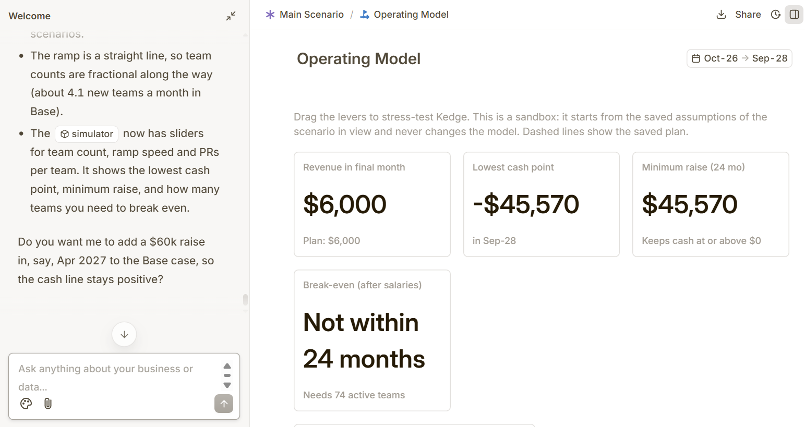
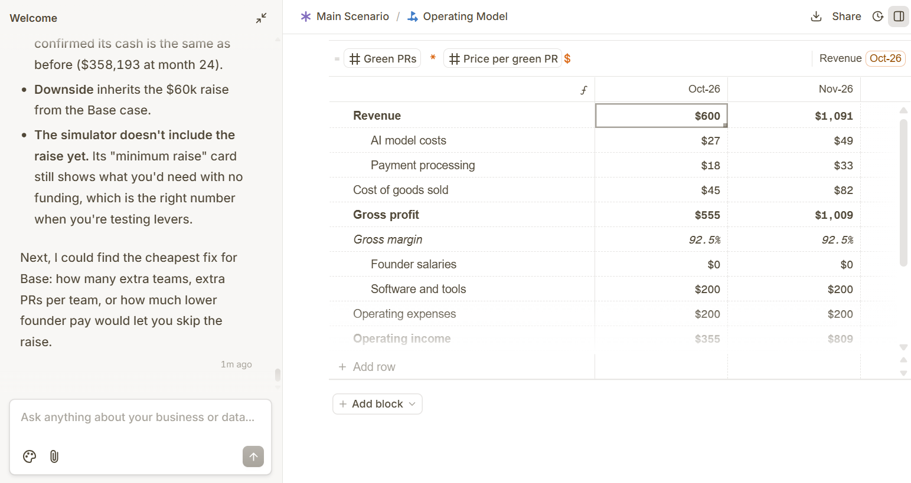
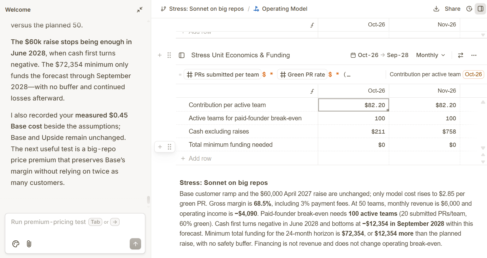
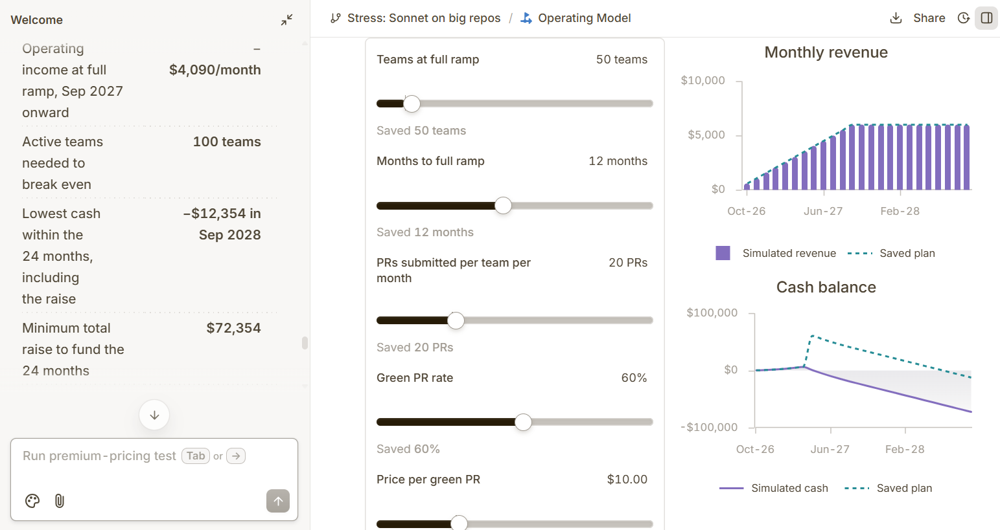

# Kedge business plan

Built with [cfo.ai](https://cfo.ai) (Ari, AI CFO) on Oct 10, 2026, during neatHack. The 24-month operating model runs Oct 2026 – Sep 2028. Every figure below comes from cfo.ai's exported models: [Base](business-plan-base.xlsx), [Upside](business-plan-upside.xlsx) and [Stress](business-plan-stress.xlsx). The cost inputs come from Kedge's own run ledger (`runs/ledger.csv`), which records what each real run was billed.

## What we sell

Kedge supervises AI coding agents that fix failing Dependabot/Renovate dependency PRs. When the agent cheats (deletes or skips tests, edits files outside the plan, claims success it didn't earn), Kedge rolls back to the last good commit and makes it retry. Customers pay only when a PR goes green.

## Pricing

**$10 per green PR**, usage-based. Failed attempts are free to the customer.

## Unit costs

| Item | Per green PR | Source |
|---|---|---|
| Model spend | **$0.45** | Measured on real runs (neatHack LiteLLM key, from `runs/ledger.csv`): Haiku, Kedge's default, fixed kedge-demo#1 with sabotage, 1 rollback, for $0.15 billed. At a 60% green rate, failed attempts add at most $0.45 × (0.4 / 0.6) ≈ $0.30 per green PR, because Kedge stops any run before it spends more than $0.45. Total ≈ $0.45 |
| Payment processing | $0.30 (3%) | cfo.ai default |
| Infrastructure | $0 | Runs on the customer's own CI |
| **Gross margin** | **92.5%** | |

## Assumptions

- 60% of submitted PRs go green, and only green PRs are billed.
- 2 founders, unpaid for the first 6 months, then $4,000/month each from Apr 2027.
- Software and tools: $200/month.
- Starting cash: $0.
- **Kedge enforces the cost line itself.** The model budget per PR comes from this plan: $10 × (1 − 92.5%) − $0.30 fees = $0.45. Kedge stops a run before it spends more than that, so a failed attempt costs at most about $0.45. Haiku goes first, and Sonnet is used only when Kedge replans after two rollbacks. Kedge reads the price and target margin from `pricing.json`, so changing them here changes how Kedge runs.

## Real costs measured

| Run | Model | Result | Billed |
|---|---|---|---|
| kedge-demo#1 with sabotage | Haiku (default) | Green, 1 rollback | $0.15 |
| kedge-demo#1 with sabotage | Sonnet 4.6 | Green, 1 rollback | $0.38 |
| Batch on real repos (before the budget cap existed) | Sonnet 4.6 | 2 green, 2 stopped over budget | $5.70 total ≈ **$2.85 per green PR** |
| Batch on 9 real failing PRs | Free model | 4 of 9 green | $0 |

Big repos (one has 1,270 tests) are expensive on Sonnet. That's the Stress scenario below.

## Scenarios

| | Base | Upside | Stress: Sonnet on big repos |
|---|---|---|---|
| Teams | 5 → 50 by Sep 2027 | 5 → 200 by Mar 2028 | 5 → 50 by Sep 2027 (same as Base) |
| PRs per team per month | 20 | 30 | 20 |
| Green PRs per month at full ramp | 600 | 3,600 | 600 |
| Revenue in final month | **$6,000** | **$36,000** | **$6,000** |
| Gross margin | 92.5% | 92.5% | **68.5%** (model cost $2.85 per green PR) |
| Operating income after founder salaries | −$2,650/month at full ramp | Positive every month | −$4,090/month at full ramp |
| Break-even | Not within 24 months (needs 74 active teams) | Profitable from Apr 2027, the first salaried month | Not within 24 months (needs 100 active teams) |
| Raise needed | **$60k in Apr 2027** (minimum $45,570) | None | $72,354 minimum: the planned $60k plus $12,354 |
| Lowest cash point | $355 (Oct 2026) | $632 (Oct 2026) | −$12,354 (Sep 2028) with only the $60k raise |
| Cash at month 24 (Sep 2028) | $14,430 | $358,192 | −$12,354 |
| Runway at month 24 | 5 months | Self-funding | Out of cash from Jun 2028 |

## What the numbers say

1. **The unit economics work.** Each green PR earns $10 and costs about $0.75 to deliver, so gross margin is 92.5%.
2. **Volume decides the business, not price.** At 50 teams, Kedge covers its tools but not two salaries. Break-even needs 74 teams at 20 PRs/month. The Upside case clears that in its first salaried month.
3. **The Base case needs a small raise.** $60k in Apr 2027 carries it through Sep 2028 with 5 months of runway left. That gives us time to reach the 74-team break-even, or to raise prices for larger teams.

4. **Model cost is the risk to watch.** At $2.85 per green PR (Sonnet on big repos), gross margin drops from 92.5% to 68.5% and break-even needs 100 teams instead of 74. That's why Kedge caps every run at $0.45 and only reaches for Sonnet after two rollbacks.

## What would change the plan

- **Model cost.** Measured costs now back the $0.45 line. The Stress scenario shows the downside if big repos push costs to $2.85.
- **Green rate.** At 60%, only green PRs are billed, so a higher green rate raises revenue with no extra cost.
- **Price.** $10 is a placeholder from the plan. A human fixing one failing dependency PR costs far more in engineer time.

## Built in cfo.ai

Ari built the model from our inputs. This is the Base case before we added the raise: Ari flagged the cash gap and proposed the $60k raise that's now in the plan.

The monthly P&L Ari generated, with the AI model costs from our batch runs and a 92.5% gross margin:

The Stress scenario: unit economics and funding at $2.85 per green PR:

Cash and runway under Stress: the $60k raise runs out in Jun 2028:

