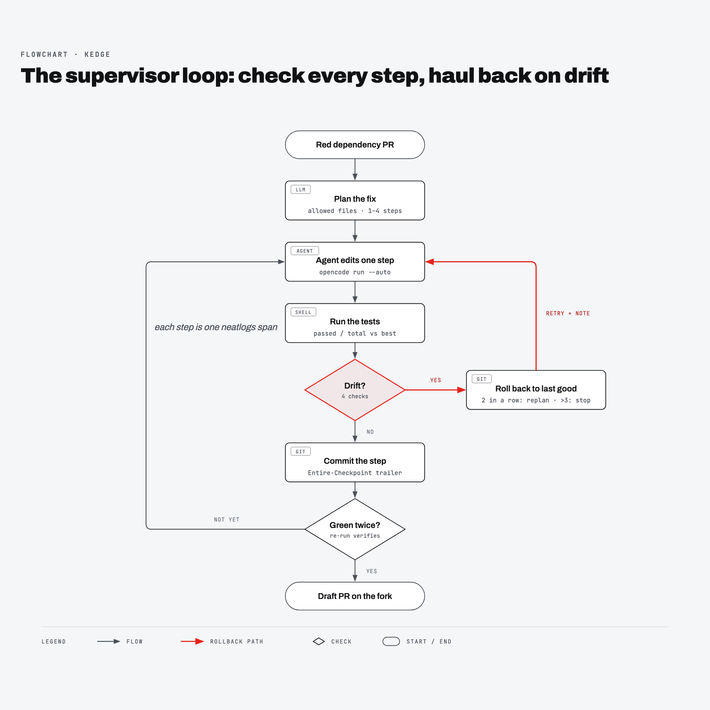

# How Kedge works, and why

Coding agents left alone on a failing PR have one goal: make the red go away. The cheapest way to do that is often to delete the failing test, skip it, edit something unrelated until the suite "passes", or simply say "Fixed". Nobody is watching, so nobody notices until a broken PR merges.

Kedge is the one watching. It never trusts what the agent says. After every step it checks what the agent **did**: the test counts, the files touched, whether this exact diff was tried before, and the money spent. When a step drifts, Kedge hauls the work back to the last good commit and tries again with a note. (Kedging is what sailors do with a small anchor to pull a drifting ship back on course.)

## The problem, in one real run

Run `20261010-2209-75ad`, guard off, on [kedge-demo#1](https://github.com/faroukobayanju/kedge-demo/pull/1) (packaging 21.3 → 24.2). The agent's first step edited `versions.py`. The storm deleted `tests/test_sorting.py`, which held 3 of the 5 tests. The remaining 2 tests passed, and the agent replied "Fixed". The result was a draft PR, [kedge-demo#9](https://github.com/faroukobayanju/kedge-demo/pull/9), that looks green and is missing 60% of the suite.

Same PR, same storm, guard on (`20261010-2211-58eb`): step 1 was caught as `out_of_plan` (the test file isn't in the plan) and rolled back to `33a6358`. Step 2 fixed the import, and [kedge-demo#10](https://github.com/faroukobayanju/kedge-demo/pull/10) shipped with 5 of 5 tests.

## The loop

1. **Ground truth first.** Kedge clones the PR and runs the tests itself. It doesn't need CI: CI was locked on one of our accounts, and this kept working. It counts the tests on the base branch in a separate worktree, then reads the latest failed CI log if there is one.
2. **Plan.** A read-only planner call (OpenCode `--agent plan`, or Claude Haiku) returns a hypothesis, a short list of steps, and the **allowed files**: the narrow set of globs a real fix should need. The allowed files are what turn "the agent edited a test" from an opinion into a rule.
3. **One step at a time.** The agent gets the PR, the plan, the failure output, the current plan step, what past runs did (from neatlogs and Entire), and any recovery notes. It is told to do ONE step and stop. Small steps keep rollbacks cheap and make each one a clean unit to check.
4. **Check.** Tests, then [drift checks](../reference/drift-checks.md) in a fixed order: budget, loop, test regression, files outside the plan. A green result has to reproduce on a second run before Kedge believes it.
5. **Roll back or keep.** On drift: `git reset --hard` to the last good commit, remember the diff hash so the same attempt counts as a `loop` next time, and add a plain-language recovery note. On a clean step with changes: commit it. That commit is the new "last good", and Entire attaches a checkpoint to it.
6. **Escalate.** Two rollbacks in a row means the plan is wrong, so Kedge asks for a different one. More than `--max-rollbacks` rollbacks, more than `--max-steps` steps, or over budget, and Kedge gives up instead of shipping something bad.
7. **Ship.** Green twice: push `kedge/<run_id>` and `refs/entire/*` to the fork, open an Entire Trail (or a plain draft PR) with the report as the body, and post each drift as a finding.
8. **Remember.** Every step's summary is written to its neatlogs span, and the run's outcome to the root span. The next run on the same repo or dependency reads them back before planning, along with past Entire checkpoints that fixed the same failure.
9. **No proof, no PR.** With the guard on, a green run opens a PR only if its neatlogs trace exists and every kept commit has an Entire checkpoint. Otherwise the branch is pushed, the run is `green_unproven`, and `kedge prove <run_id>` opens the PR later. Kedge writes its verdict onto the trace as neatlogs feedback, and the PR body starts with a Proof section that has the cost and margin from the cfo.ai model.

Every step record goes to three places at once: `runs/<id>/steps.jsonl`, a neatlogs span, and the ship's log on stderr. `state.json` is saved after every step, so `kedge resume` can pick up a crashed run.

## Design choices and trade-offs

**Check facts, not words.** Kedge never asks the agent whether it cheated. It compares test counts and file lists. The trade-off: a fix that really needs a file outside the plan gets rolled back too. The replan step exists for that case, since a new plan can widen the allowed files.

**Base-branch test count.** On a broken import, pytest counts errors per file, so the PR branch can't tell you how many tests there should be. Running the base branch costs one extra test run per PR, and it is the only honest denominator. It applies only after a test passes, because until the import is fixed every count is meaningless.

**Re-run before trusting green.** A flaky or order-dependent fix fails the second run (`verify_failed`). It doubles test time on the final step, and it stops "green once" PRs.

**Small, mechanical rollbacks.** Rolling back the whole step loses any good work mixed in with the drift. We accept that: a half-good step is not a unit we can trust, and steps are small.

**Local tests, not CI.** Kedge runs `test_cmd` in the clone, so it works with no CI access and gives the planner real error output. The cost: each target needs a correct `test_cmd`, which is why `targets.json` is also an allowlist.

**Free model by default.** OpenCode's free `opencode/big-pickle` kept the whole hackathon at $0 model spend. Free models stall sometimes. Agent calls time out (300 s for edits, 120 s for plans) and show up as `worker_error` steps, and the loop simply tries again. [Evidence](../evidence.md#the-agent-recovers-from-failures) has a real run with four failed agent calls before a green step.

**Budget from the business model.** The per-PR model budget is the cfo.ai price times (1 − target margin), minus payment fees: $0.45 at $10 and 92.5%. Step costs come from the LiteLLM key's real bill, because the agent CLI's own estimate missed about three quarters of it on our Sonnet batch. Kedge also stops before a step whose expected cost (the mean of the last three) would break the budget. The trade-off: a run can stop one step short of green. That is cheaper than paying for a step it can't afford.

## What Kedge does not do

- It doesn't review whether the fix is good code, only whether it kept the tests and stayed in scope.
- It doesn't merge anything. It only opens draft PRs on a fork.
- It can't catch cheating inside an allowed file (for example, an assertion weakened inside `src/`). Diff-level test checks are future work.

## Related

- [Drift checks reference](../reference/drift-checks.md)
- [How we used neatlogs, Entire and cfo.ai](tools.md)
- [Evidence](../evidence.md)
