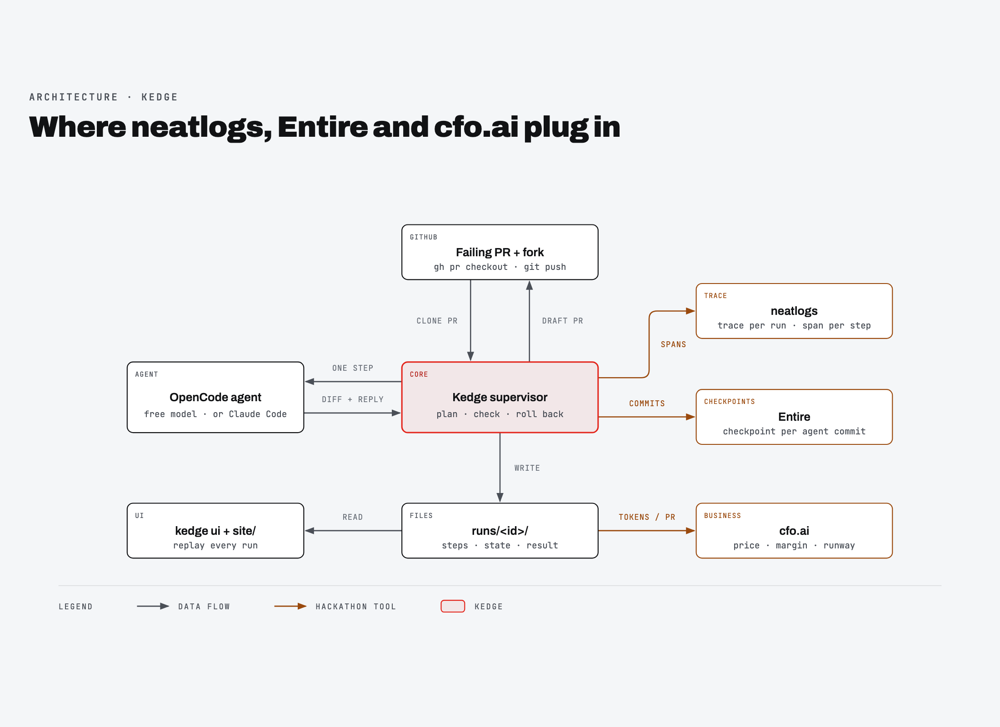

# Integrations: neatlogs, Entire, cfo.ai

What each tool receives from Kedge, and where it lives in the code. For why we used them the way we did, see [How we used neatlogs, Entire and cfo.ai](../explanation/tools.md).



## neatlogs

Code: `kedge/trace.py`. SDK: `neatlogs>=1.4.26` (Python). Readback: the neatlogs npm CLI (0.2.1).

**Setup.** `trace.start()` calls `neatlogs.init(api_key=NEATLOGS_API_KEY, endpoint="https://ingest.neatlogs.com", workflow_name="dependency-pr-repair", tags=[...])`. With no `NEATLOGS_API_KEY`, every trace call is a no-op.

**Tags for memory.** Every trace is also tagged `repo:<owner/repo>` and `dep:<package>`.

**One trace per run.**

| Span | Kind | Attributes |
|---|---|---|
| `kedge run <run_id>` | `WORKFLOW` (root) | `kedge.run_id`, `kedge.pr_url` |
| `step <n> <action>` | `TOOL` (`AGENT` for `replan`) | Every field of the [step record](run-files.md#step-record-stepsjsonl), as `kedge.<field>` (lists JSON-encoded) |

Trace tags: `run_id:<id>`, `pr_url:<url>`, `guard:on|off`, `storm:<mode>|off`.

**Span input and output.** neatlogs doesn't return custom attributes on read, but it keeps each span's input and output preview. So every step span's `output.value` is a JSON summary (`step`, `action`, `drift`, `tests`, `files`, `rolled_back`, `false_claim`, `cost_usd`), and the root span's output is the run's outcome (`status`, `rollbacks`, `green_files`, `cost_usd`).

**Memory.** Before planning, `trace.memory()` lists traces tagged with the same `repo:` or `dep:`, reads their spans with `traces raw-spans`, and turns them into lines such as `run_id:… ; drifted: step 1 tests_regressed on [...]; went green editing ['versions.py']` for the planner and the agent prompt.

**Verdict.** After the run, `trace.verdict()` writes Kedge's judgement onto the trace with `feedback create`: a rating (100 clean green, −30 green after a caught drift, −100 failed), the drift kinds as `issueTypes`, and a comment listing each caught step. This needs a CLI login with the `observability:write` scope.

**Readback.** After the run, `trace.trace_url()` runs the npm CLI with the service-account token, never the ingest key:

```bash
~/.local/bin/neatlogs --host https://app.neatlogs.com --profile setup-https---app-neatlogs-com \
  --project "$NEATLOGS_PROJECT_ID" traces list --workflow dependency-pr-repair --limit 50 --json
```

It finds the trace tagged `run_id:<id>` and stores its `traceId` in `result.json` as `trace_url`. The API returns no URL field, so Kedge stores the ID. If the trace hasn't been ingested yet, it stores `unavailable`. The trace still exists; find it later with the same command.

**Finalization delay.** A trace can sit in `"finalizationStatus": "dlq"` or `pending` with 0 spans, sometimes named after its first step, for hours before neatlogs finalizes it with the full tree. Every trace from our runs eventually finalized. Re-query instead of re-running.

## Entire

Code: `kedge/cli.py:run_one`, `kedge/gitgh.py`, `kedge/trails.py`. CLI: Entire 0.11.4.

**Capture inside each run.** In the fresh clone, Kedge runs `entire enable --agent opencode` (or `claude-code`). If the OpenCode plugin file `.opencode/plugins/entire.ts` is missing afterwards, it re-runs with `--force`. Entire's hooks then watch the agent session. Every `git commit` Kedge makes for a clean step gets an `Entire-Checkpoint: <id>` trailer, which `gitgh.commit()` reads back into the step record.

**OpenCode version pin.** OpenCode v2 rejects Entire's plugin ("Plugin must export a default definition…"), so Entire never sees the session. `scripts/setup-opencode.sh` installs OpenCode **1.18.35** into `.tools/opencode`. `worker.use_pinned_opencode()` puts it first on `PATH` with its own XDG data dirs, because Entire's commit hook shells out to `opencode export` and must hit the same binary. The agent also runs with `--dir <clone>`, `PWD=<clone>` and `stdin=DEVNULL`. Without those, OpenCode resolves the wrong project or skips the plugin.

**Fix memory.** Before planning, `trails.past_fixes()` runs `entire checkpoint search "fix <PR title>" --all-repos` in the clone, keeps the top 2 distinct checkpoints, and reads each one's `## Files` section with `entire checkpoint explain`. The planner sees lines like `Entire checkpoint 01M4M45D… (kedge-demo): "Fix packaging LegacyVersion Import Error", touched ['versions.py']`.

**Explain.** At the end of a run, Kedge runs `entire checkpoint explain <last checkpoint>` and puts the output in `result.json` (`entire_explain`) and in the report and PR body.

**Publishing.** `gitgh.push_branch()` also pushes `refs/entire/*` to the fork, so checkpoints are public next to the branch:

```bash
git ls-remote https://github.com/faroukobayanju/kedge-demo.git 'refs/entire/*'
```

**Trails.** On a green run Kedge first tries `entire trail create --repo gh/<fork> --branch kedge/<run_id> --base <default> --type bug ...`, which opens the PR. It then posts one finding per drift (`entire trail finding add`) and resolves the ones it recovered from. If Trails isn't enabled for the repo (early access), it falls back to `gh pr create --draft`.

## cfo.ai

Code: `kedge/money.py`, `pricing.json`. cfo.ai has no public API, so its model reaches Kedge through `pricing.json`: price per green PR ($10), target gross margin (92.5%) and payment fee rate (3%).

- **Budget:** price × (1 − margin) − price × fee = **$0.45** of model spend per PR, unless `--budget` is given.
- **Real cost:** with a `litellm/*` model, `money.Meter` reads the key's spend from LiteLLM's `/key/info` before and after every agent call. The difference is the step's real cost.
- **Stop before overspending:** Kedge skips a step whose expected cost would break the budget.
- **Margin line:** every PR body says what the fix cost and the margin it leaves at the cfo.ai price.
- **Ledger:** `runs/ledger.csv` gets one row per run, ready to load back into cfo.ai.

The plan itself was built with cfo.ai's Ari: [business-plan.md](../business-plan.md) and [business-plan.pdf](../business-plan.pdf).

## Related

- [Evidence](../evidence.md)
- [CLI reference: environment](cli.md#environment)
